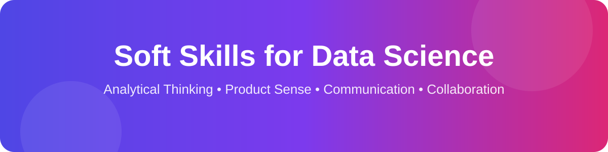
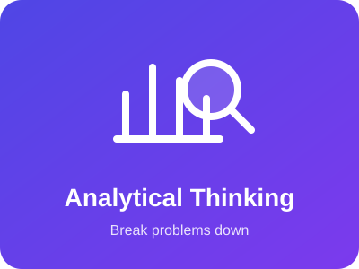
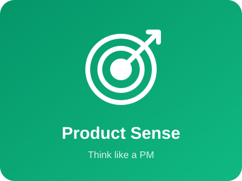
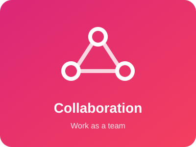
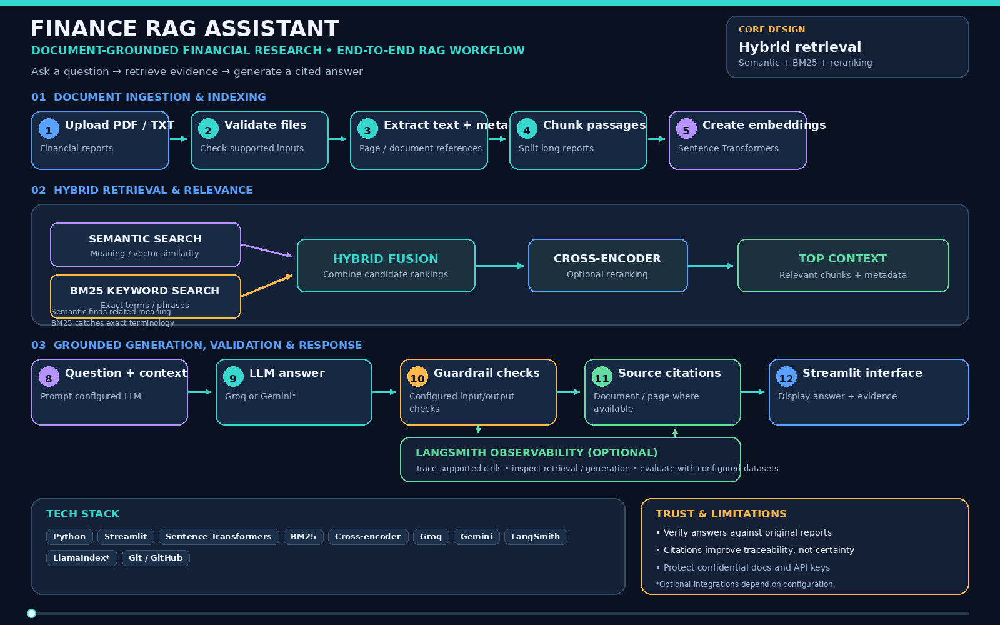
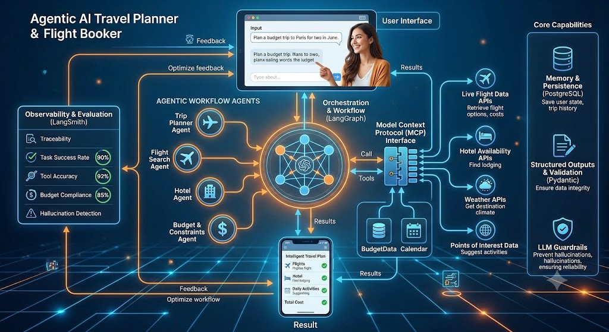
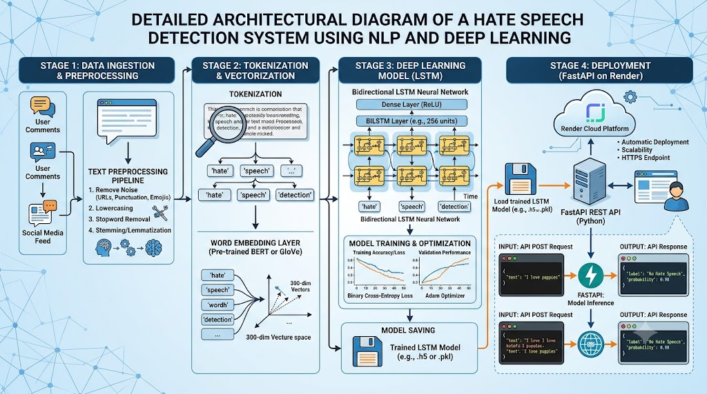
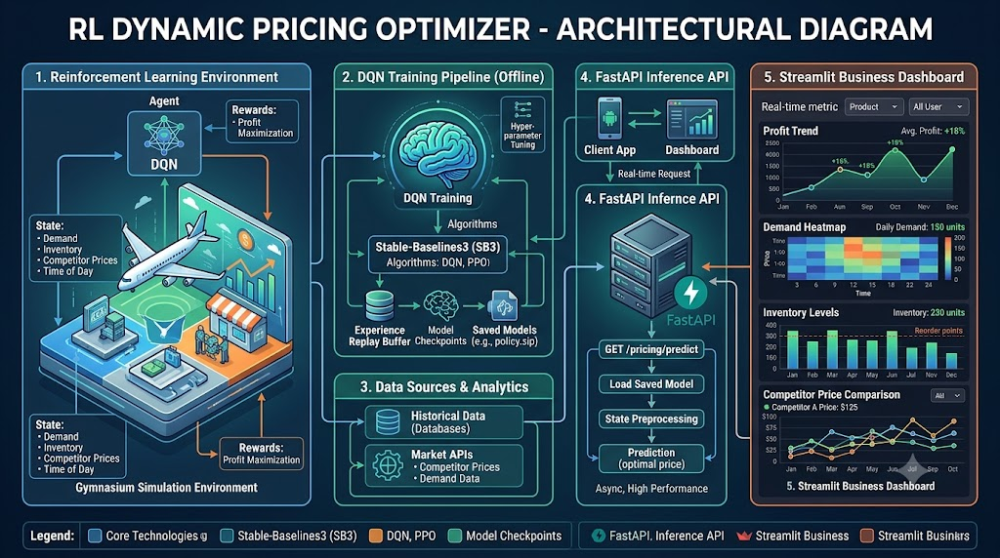
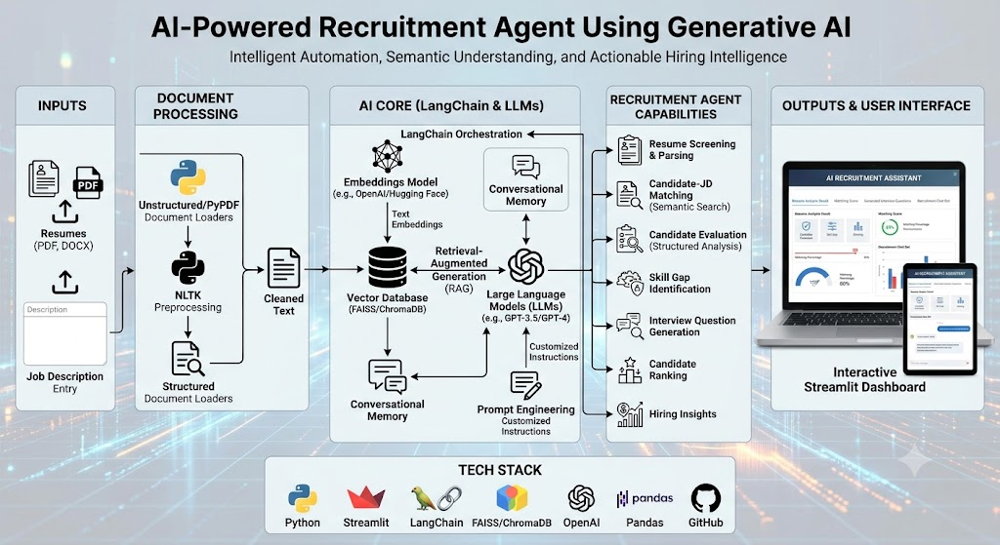

 

---

## 👨‍💻 About Me

I'm an **Applied Data Scientist , Data Analyst & AI ML Engineer** who turns raw data into actionable business insights and builds intelligent applications that solve real-world problems.

- 📊 Analyze business performance, revenue, pricing, and customer trends using Python, SQL, statistics, and visualization.
- 🧠 Build machine learning and deep learning solutions for classification, forecasting, anomaly detection, and predictive analytics.
- 🧬 Work with neural networks, CNNs, RNNs, LSTMs, and Transformer-based approaches for image and text tasks.
- 🤖 Build Generative AI applications using RAG, hybrid retrieval, embeddings, reranking, and grounded generation.
- 🔗 Explore agentic AI with LangGraph, tool calling, MCP, multi-agent workflows, memory, and human-in-the-loop controls.
- ⚙️ Develop modular ML pipelines, REST APIs, evaluation workflows, and deployment-ready applications.
- 📈 Translate statistical analysis and experimentation into practical business recommendations.
- 💹 **Domain focus:** finance, sales analytics and forecasting, trading research, and portfolio analytics.

🎓 **MCA — Artificial Intelligence, Machine Learning & Data Science**, Manipal University Jaipur

### 📈 Selected Impact

<table>
  <tr>
    <th>Business Analytics</th>
    <th>Machine Learning</th>
    <th>Forecasting</th>
    <th>Dynamic Pricing (Simulation)</th>
  </tr>
  <tr>
    <td align="center"><b>5%</b> reported sales increase contribution</td>
    <td align="center"><b>98%</b> reported model accuracy (APS project)</td>
    <td align="center"><b>8.5%</b> reported MAPE on unseen data</td>
    <td align="center"><b>+2% revenue / +3% profit</b> vs. fixed-price baseline</td>
  </tr>
</table>

Figures reflect reported project or work results. Results depend on the dataset, baseline, and evaluation method, and are not guarantees of future performance.

## 🧭 Technical Focus

<table>
  <tr>
    <th>📊 Data Analytics</th>
    <th>🧠 Machine Learning</th>
    <th>🧬 Deep Learning</th>
    <th>🤖 Generative AI</th>
    <th>🔗 Agentic AI</th>
  </tr>
  <tr>
    <td align="center">BI, dashboards, hypothesis testing</td>
    <td align="center">Training, tuning, evaluation</td>
    <td align="center">CNNs, RNNs, LSTMs, Transformers</td>
    <td align="center">RAG, hybrid search, reranking</td>
    <td align="center">Tool calling, state, memory, orchestration</td>
  </tr>
</table>

---

# 💹 My Domain: Finance, Sales Forecasting, Trading & Portfolio Analytics

I apply data science to **money and decisions**: predicting sales, understanding financial data, researching trading ideas, and measuring portfolio risk and return. My goal is simple: turn numbers into decisions that can be tested and explained.

### 🧭 What each area means for me

- **💰 Finance analytics:** reading financial documents and transactions with AI, and detecting unusual or fraudulent activity.
- **🛒 Sales analytics:** studying revenue, pricing, and customer trends, and testing business changes with A/B tests and confidence intervals.
- **📉 Forecasting:** predicting future sales and demand with ARIMA, SARIMA, and Prophet, and judging models with error metrics such as MAPE.
- **📈 Trading research:** learning how to build and test trading ideas the careful way: clean data, return and volatility features, backtests with costs, walk-forward validation, and risk checks.
- **🧺 Portfolio analytics:** measuring return, volatility, Sharpe ratio, drawdown, and Value at Risk (VaR), and using mean-variance optimization to explore the risk-return trade-off.

<table>
  <tr>
    <th>Area</th>
    <th>What I work on</th>
    <th>Related work</th>
  </tr>
  <tr>
    <td>Finance analytics</td>
    <td>Grounded Q&amp;A on financial documents, fraud detection</td>
    <td><a href="https://github.com/TusharK93/Financial-Rag-Project">Finance RAG Assistant</a> · <a href="https://github.com/TusharK93/AI-Powered-Credit-Card-Fraud-Detection-Dashboard">Fraud Detection Dashboard</a></td>
  </tr>
  <tr>
    <td>Sales analytics</td>
    <td>Revenue and pricing analysis, A/B testing, confidence intervals</td>
    <td>Data Analyst role at The WoodenPath (reported <b>5%</b> sales increase)</td>
  </tr>
  <tr>
    <td>Forecasting</td>
    <td>ARIMA, SARIMA, Prophet, trend and seasonality, MAPE</td>
    <td><a href="https://github.com/TusharK93/Sales-Forecasting-System-using-Flask-and-Prophet---Time-Series-Project">Sales Forecasting System</a> (reported <b>8.5%</b> MAPE)</td>
  </tr>
  <tr>
    <td>Pricing strategy</td>
    <td>Reinforcement learning for pricing decisions</td>
    <td>Dynamic Pricing Optimizer (simulation: <b>+2%</b> revenue, <b>+3%</b> profit vs baseline)</td>
  </tr>
  <tr>
    <td>Trading research</td>
    <td>Backtesting, walk-forward validation, risk checks</td>
    <td>Currently Working on Trading based Algorithms</td>
  </tr>
  <tr>
    <td>Portfolio analytics</td>
    <td>Mean-variance optimization, Sharpe ratio, drawdown, VaR</td>
    <td>Currently Working on Portfolio Managment</td>
  </tr>
</table>

Trading and portfolio work is a learning and research focus. I do not claim live trading results. Nothing here is financial advice.

### 🔄 Domain Pipelines

#### 1. Sales and Financial Forecasting

  

#### 2. Trading Research

  

#### 3. Portfolio Analytics

  

### 🎬 Concept Demos (Animated)

These four demos explain core ideas. They use **synthetic (made-up) data** so you can see how the methods works**.

  
    
  
    
  
    
  

Demo data is randomly generated for illustration. Backtest results on random data say nothing about real markets.

---

# 🏗️ Production-Oriented AI Pipelines

These diagrams show architecture patterns I work with and explore. Individual projects may implement different subsets of these components.

## 1. 🧠 Production Machine Learning Pipeline

  

**Key capabilities:** Python, Pandas, NumPy, scikit-learn, imbalanced-learn, XGBoost, Optuna, MLflow, DVC, FastAPI, Flask, Docker, Render, logging, validation, monitoring.

**Example projects:** [APS Failure Detection](https://github.com/TusharK93/-Air-Pressure-System-APS-Project-Using-Machine-Learning) · [Kidney Disease Classification](https://github.com/TusharK93/Kidney-Disease-Classification-Project---Deep-Learning) · [Sales Forecasting](https://github.com/TusharK93/Sales-Forecasting-System-using-Flask-and-Prophet---Time-Series-Project)

## 2. 🧬 Deep Learning Pipeline

  

- **Architectures:** ANN, CNN, RNN, LSTM, GRU, Transformers, GPT, BERT
- **Frameworks:** TensorFlow, Keras, PyTorch
- **Computer vision:** resizing, normalization, augmentation, image classification, object detection concepts
- **NLP:** text preprocessing, embeddings, sequence models, text classification
- **Evaluation:** accuracy, precision, recall, F1-score, confusion matrices, error analysis
- **Deployment:** saved models, consistent preprocessing, REST APIs, Flask/FastAPI, Docker

**Example projects:** [Kidney Disease Classification](https://github.com/TusharK93/Kidney-Disease-Classification-Project---Deep-Learning) · [Hate Speech Detection](https://github.com/TusharK93/Hate-Speech-Classification-Project---NLP-Natural-Language-Processing-)

Medical image classification in this portfolio is educational and is not a clinically validated diagnostic service.

## 3. 🤖 Production Generative AI & RAG Pipeline

  

**Key capabilities:** BM25, vector search, embeddings, semantic search, metadata filtering, hybrid search, cross-encoder reranking, LangChain, LlamaIndex, Sentence Transformers, Groq, Gemini, structured outputs, guardrails, caching, rate limiting, LangSmith, observability fundamentals.

**Example project:** [Finance RAG Assistant](https://github.com/TusharK93/Financial-Rag-Project) · [Live Demo](https://financial-rag-projectgit-mehrafevet4cygzuycio2f.streamlit.app/)

## 4. 🔗 Production-Oriented Agentic AI Pipeline

  

**Key capabilities:** LangGraph, LangChain, multi-agent coordination, conditional routing, MCP, API tools, Pydantic validation, structured outputs, checkpointing, PostgreSQL-backed memory, human-in-the-loop approval, LangSmith tracing, guardrails, logging.

**Example project:** [Agentic AI Travel Planner & Flight Booker](https://github.com/TusharK93/Agentic-AI-Project---Flight-Booker) · [Live Demo](https://agentic-ai-project-flight-booker-2-8v2r.onrender.com/)

## 5. 📊 Data Analytics Pipeline

  

**Key capabilities:** SQL, Pandas, Excel, Tableau, Power BI, KPI analysis, A/B testing, confidence intervals, hypothesis testing, dashboard development.

**Example projects:** [Music Store Data Analysis](https://github.com/TusharK93/-Music-Store-Data-Analysis-project-using-SQL) · [Credit Card Fraud Detection Dashboard](https://github.com/TusharK93/AI-Powered-Credit-Card-Fraud-Detection-Dashboard)

## 6. 📉 Time Series Forecasting Pipeline

  

**Key capabilities:** ARIMA, SARIMA, Prophet, stationarity checks, ACF/PACF, trend and seasonality analysis, forecast evaluation (MAPE), Flask deployment.

**Example project:** [Sales Forecasting System](https://github.com/TusharK93/Sales-Forecasting-System-using-Flask-and-Prophet---Time-Series-Project) · [Live Demo](https://sales-forecasting-system-using-flask-and-8qbi.onrender.com/)

## 7. 💬 NLP Pipeline

  

**Key capabilities:** text preprocessing, TF-IDF, NLTK, spaCy, GloVe, Word2Vec, LSTM text classification, Hugging Face, Flask/FastAPI inference.

**Example project:** [Hate Speech Detection](https://github.com/TusharK93/Hate-Speech-Classification-Project---NLP-Natural-Language-Processing-) · [Live Demo](https://hate-speech-classification-project-nlp-24qa.onrender.com/)

---

## 🛠️ Technical Skills

### 🤖 Generative AI & Agentic AI
`RAG` · `Hybrid Search` · `BM25` · `Reranking` · `Embeddings` · `Semantic Search` · `Metadata Filtering` · `Grounded Generation` · `LangGraph` · `LlamaIndex` · `LangChain` · `Semantic Kernel (Basics)` · `MCP` · `Tool Calling` · `Multi-Agent Systems` · `State Management` · `Checkpointing` · `Structured Outputs` · `Prompt Engineering` · `Context Engineering` · `LLM Evaluation` · `LLM Guardrails` · `LangSmith` · `Tracing` · `OpenTelemetry (Basics)` · `Arize Phoenix (Basics)` · `Vector Databases` · `LLMs` · `Human-in-the-Loop`

  
  
  
  
  
  
  

### 🐍 Programming Languages & Databases
`Python` · `SQL` · `MySQL` · `PostgreSQL` · `Redis` · `Data Structures & Algorithms`

### 📊 Machine Learning & Statistics
`Regression` · `Classification` · `Clustering` · `Anomaly Detection` · `Dimensionality Reduction` · `Feature Engineering` · `Model Evaluation` · `Cross-Validation` · `XGBoost` · `scikit-learn` · `imbalanced-learn` · `Optuna` · `Hypothesis Testing` · `A/B Testing` · `Chi-Square Testing` · `Confidence Intervals` · `Statsmodels` · `SciPy` · `Autoencoders`

### 🧬 Deep Learning
`ANN` · `CNN` · `RNN` · `LSTM` · `GRU` · `Transformers` · `GPT` · `BERT` · `TensorFlow` · `Keras` · `PyTorch` · `Transfer Learning` · `Image Augmentation`

### 📉 Time Series & Forecasting
`ARIMA` · `SARIMA` · `Stationarity` · `AR / MA` · `ACF/PACF` · `Prophet` · `Statsmodels` · `Trend and Seasonality` · `Forecast Evaluation`

### 💬 NLP & Computer Vision
`Text Preprocessing` · `TF-IDF` · `NLTK` · `spaCy` · `GloVe` · `Word2Vec` · `Text Classification` · `Image Classification` · `RCNN` · `Fast R-CNN` · `Faster R-CNN` · `Hugging Face`

### 📈 Data Analytics & Big Data
`Excel` · `Pandas` · `NumPy` · `Matplotlib` · `Seaborn` · `Tableau` · `Power BI` · `Business Intelligence` · `Dashboard Development` · `KPI Analysis` · `Databricks (Basics)` · `PySpark` · `Kafka`

### ⚙️ Tools, Deployment & MLOps
`FastAPI` · `Flask` · `Django` · `Streamlit` · `Docker` · `Render` · `Git` · `GitHub` · `Azure` · `AWS` · `MLflow` · `MLOps` · `CI/CD` · `REST APIs` · `Web Scraping` · `Selenium` · `Requests` · `BeautifulSoup`

  

---

  

## 🧠 Soft Skills for Data Science

Technical skills get you the interview, but soft skills decide how much impact you have. These are the four  **I focus on **.

### 1. 🔍 Analytical Thinking

Breaking a vague problem into smaller, testable questions.
- Define the problem before touching the data
- Form hypotheses, then validate them with evidence
- Question assumptions, spot bias, and separate correlation from causation
- Sanity-check results ("Does this number even make sense?")

 

### 2. 🎯 Product Sense

Understanding the *why* behind the analysis, not just the *how*.
- Connect models and metrics to real user and business goals
- Choose metrics that matter (e.g. retention over vanity clicks)
- Prioritize work by impact versus effort
- Ask "What decision will this analysis change?"

 

### 3. 🗣️ Communication & Data Storytelling

Turning findings into something non-technical people can act on.
- Lead with the insight, not the methodology
- Use clear visuals and simple language
- Tailor the message to the audience (executives, engineers, designers)
- Be honest about uncertainty and limitations

 

### 4. 🤝 Collaboration

Data science is a team sport.
- Work closely with product, engineering, and business teams
- Give and receive feedback constructively
- Document your work so others can reproduce it
- Share credit and knowledge openly

 

---

> 💡 *"The best data scientists aren't just great with data. They're great at helping people make better decisions."*

---

## 💼 Professional Experience

### 📊 Data Analyst (Part-time) — The WoodenPath
**April 2026 – October 2026 · On-site · Jaipur, Rajasthan**

- **Business Analytics:** Analyzed sales, pricing, and revenue data using Python and statistics to identify trends and growth opportunities.
- **Experimentation:** Applied A/B testing, confidence intervals, and statistical analysis to evaluate business decisions, contributing to a reported **5% increase in sales**.
- **Business Partnership:** Worked with stakeholders to turn findings into pricing and sales recommendations.
- **Tools:** Python, Statsmodels, A/B Testing, Confidence Intervals.

### 📈 Data Analyst Intern — NullClass Pvt. Ltd.
**September 2025 – March 2026 · Remote · Tamil Nadu, India**

- **Sales Growth:** Built custom data-tracking and visualization tools that supported a reported **2% increase in quarterly course sales**.
- **Dashboards:** Used Tableau and BI techniques to present KPIs and make trends easy to understand.
- **Stakeholder Collaboration:** Held biweekly Zoom meetings to gather requirements, review progress, and align deliverables.
- **Tools:** Tableau, Business Intelligence, Data Visualization, KPI Tracking.

---

## 🚀 Featured Projects

### 🤖 Finance RAG Assistant
Financial document Q&A that combines retrieval and LLM generation to give answers grounded in uploaded material.
- Hybrid retrieval (BM25 + semantic embeddings) with reranking
- Source-aware answers, with tracing and evaluation where configured
- **Stack:** Python, Streamlit, Sentence Transformers, BM25, Groq/Gemini, LangChain, LlamaIndex
- [Live Demo](https://financial-rag-projectgit-mehrafevet4cygzuycio2f.streamlit.app/) · [Repository](https://github.com/TusharK93/Financial-Rag-Project)

  

### ✈️ Agentic AI Travel Planner & Flight Booker
Multi-agent travel planning app that coordinates tools to build plans around user requirements and budgets.
- LangGraph orchestration, LangChain, MCP, tool calling
- Human-in-the-loop approval and PostgreSQL memory where configured
- Reported evaluation: **90% task success** across 100 test requests
- [Live Demo](https://agentic-ai-project-flight-booker-2-8v2r.onrender.com/) · [Repository](https://github.com/TusharK93/Agentic-AI-Project---Flight-Booker)
 

  

### 🚛 Air Pressure System (APS) Failure Detection
Predictive maintenance project that identifies potential APS failures from vehicle sensor data.
- End-to-end ML pipeline with preprocessing and imbalance handling
- Reported results: **98% accuracy, 97% F1-score**
- **Stack:** Python, scikit-learn, XGBoost, FastAPI, MongoDB, MLflow
- [Live Demo](https://air-pressure-system-aps-project-using-0efs.onrender.com/) · [Repository](https://github.com/TusharK93/-Air-Pressure-System-APS-Project-Using-Machine-Learning)
   

  

### 💳 AI-Powered Credit Card Fraud Detection Dashboard
ML and analytics app for identifying potentially fraudulent transactions, with a dashboard for insights and model outputs.
- [Live Demo](https://ai-powered-credit-card-fraud-detection-m6g8.onrender.com/) · [Repository](https://github.com/TusharK93/AI-Powered-Credit-Card-Fraud-Detection-Dashboard)
   

  

### 📉 Sales Forecasting System
Time-series forecasting app for analyzing historical sales and supporting demand planning.
- Prophet and ARIMA workflows; trend, seasonality, ACF/PACF analysis
- Reported evaluation: **8.5% MAPE on unseen data**
- [Live Demo](https://sales-forecasting-system-using-flask-and-8qbi.onrender.com/) · [Repository](https://github.com/TusharK93/Sales-Forecasting-System-using-Flask-and-Prophet---Time-Series-Project)
   

  

### 🛑 Hate Speech Detection
NLP classifier that predicts whether text is hate speech.
- LSTM-based text classification with embeddings
- Reported results: **95% accuracy, 93% F1-score**
- [Live Demo](https://hate-speech-classification-project-nlp-24qa.onrender.com/) · [Repository](https://github.com/TusharK93/Hate-Speech-Classification-Project---NLP-Natural-Language-Processing-)
   

  

### 🩺 Kidney Disease Classification
CNN-based deep learning project for medical image classification.
- Image preprocessing, training, and evaluation
- Reported results: **94% accuracy, 92% F1-score**
- [Live Demo](https://kidney-disease-classification-project-viaa.onrender.com/) · [Repository](https://github.com/TusharK93/Kidney-Disease-Classification-Project---Deep-Learning)
 Educational project;  clinically validated diagnostic tool.
 

  

### 💰 Dynamic Pricing Optimizer
Reinforcement learning project using a Deep Q-Network agent to explore pricing decisions under changing demand.
- Reported simulation results: **2% higher revenue and 3% higher profit** vs. baseline
- **Stack:** Python, Gymnasium, Stable-Baselines3
- [Repositories](https://github.com/TusharK93?tab=repositories)
   

  

### 🧑‍💼 AI-Powered Recruitment Agent
GenAI app that assists with resume screening and candidate–job matching.
- **Stack:** Python, LangChain, RAG, Streamlit
- [Repository](https://github.com/TusharK93/AI-Powered-Recruitment-Agent---Generative-AI-Project)
   

  

### 🎵 Music Store Data Analysis
SQL analytics project exploring customer behavior, sales trends, and business insights.
- [Repository](https://github.com/TusharK93/-Music-Store-Data-Analysis-project-using-SQL)
     

  

  

---

## 📈 Project Results & Analytics (Animated)

All charts are display the some skills that used in Past Jobs and Project by me .  

### 2D Animated Charts

  
    
  
    
  

### 3D Rotating Charts

  
    
  

Metrics are as reported in each project and depend on the dataset and evaluation method. Skill counts show how many skills are listed in each category, not proficiency.

---

## 📊 GitHub Analytics

 

  

  

---

## 🎓 Education & Certifications

- 🎓 **MCA — AI, ML & Data Science**, Manipal University Jaipur · 2024–2026 · CGPA 8.0
- 🎓 **BCA**, Maharaja Vinayak Global University, Jaipur · 2021–2024 · CGPA 7.0
- 📜 **Advanced AI and Machine Learning Techniques and Capstone** — Microsoft
- 📜 **AI Capstone Project with Deep Learning** — IBM

---

## 🔄 My Data Science Workflow

  

I combine analytical thinking, statistical validation, model evaluation, and business-focused communication to turn data into useful decisions.

---

## 🌱 I have currently learned -:

- 🤖 Advanced RAG retrieval and evaluation techniques
- 🔗 Agentic AI orchestration, MCP, memory, and human-in-the-loop workflows
- 🧬 Deep learning architectures, transfer learning, and evaluation
- 📡 LLM tracing and observability with LangSmith and OpenTelemetry
- ⚙️ Reproducible ML pipelines, CI/CD, and model monitoring
- ☁️ Cloud deployment and scalable data applications
- 📊 Experiment design, forecasting, and business analytics
  
## 🌱 Currently Exploring -:

- 📈 Trading research: backtesting, walk-forward validation, and risk management
- 🧺 Portfolio analytics: mean-variance optimization, Sharpe ratio, drawdown, and VaR

---

## 😄 Fun Fact

I trained a Deep Q-Network agent to make pricing decisions. In my simulation it beat a fixed-pricing baseline by **2% in revenue and 3% in profit**. 📈🤖

---

## 🤝 Let's Connect!

**Interested in Data Analytics, Machine Learning, Deep Learning, Generative AI, Agentic AI, or solving business problems with data? Let's connect!**

  

